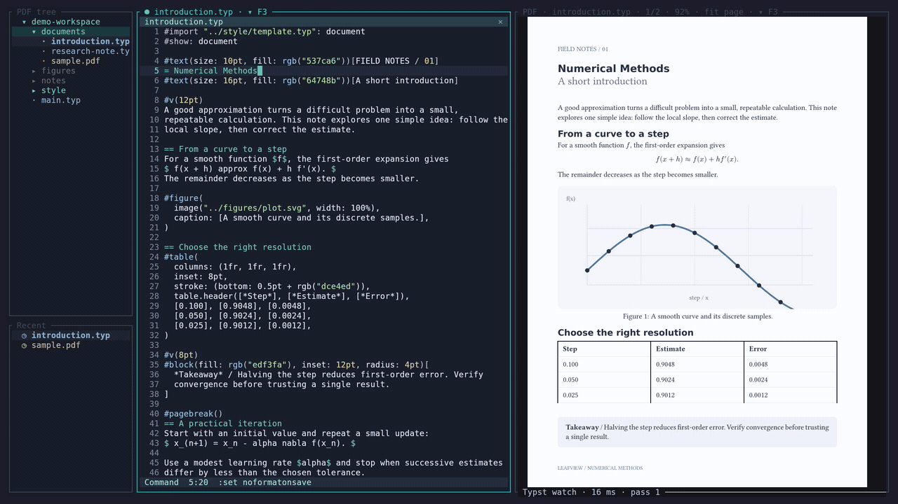
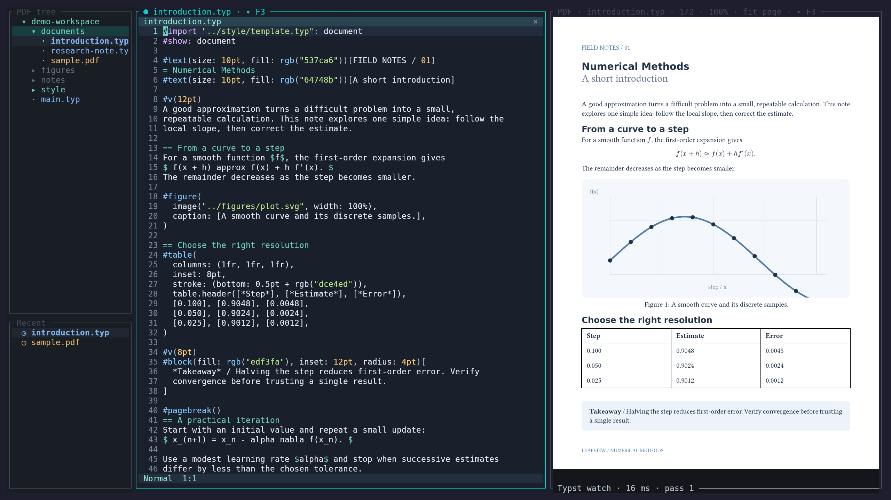
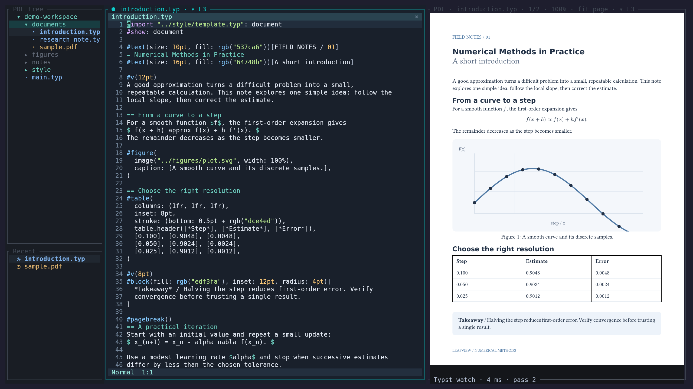
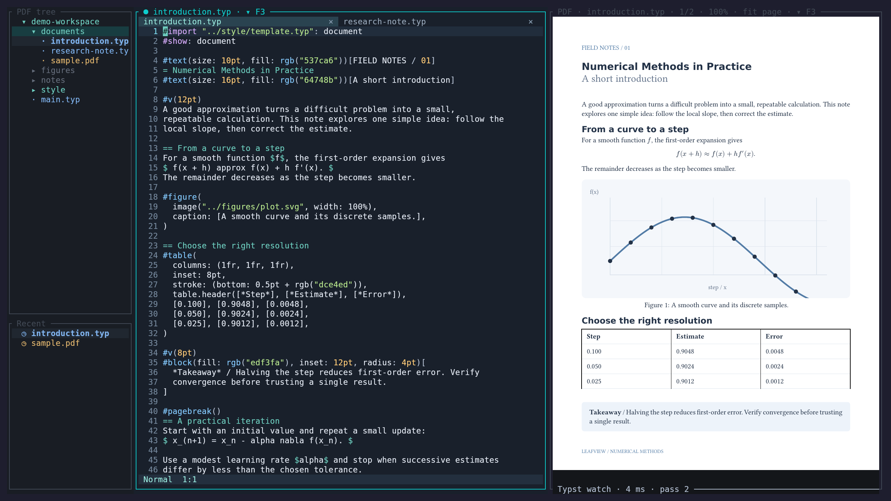
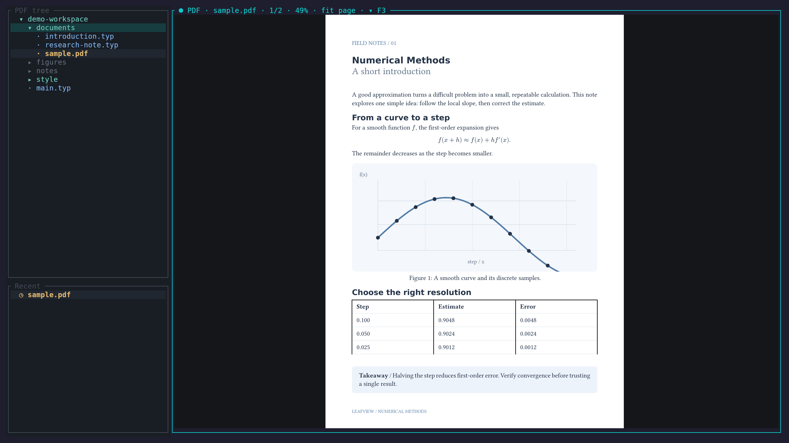
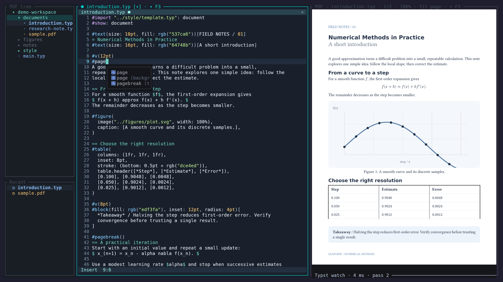

<h1 align="center">LeafView</h1>
<p align="center">A terminal PDF viewer with live Typst previews and an optional source editor.</p>
<p align="center">
  <a href="https://www.rust-lang.org/"></a>
  
  <a href="LICENSE"></a>
</p>



Read a PDF. Open its source. Save an edit and see the compiled page without leaving your terminal.

[Get started](#installation) · [Documentation](docs/README.md) · [Keyboard reference](docs/keybindings.md) · [Full walkthrough — MP4](docs/assets/demo/leafview-demo.mp4)

## Inside the terminal



Real LeafView running in Kitty with native PDF graphics. The full walkthrough starts with a default launch and PDF browsing, page turns and zoom, then moves through the directory tree into Typst editing, completion and compilation settings. All demonstration documents are synthetic.

## A document workspace, inside your terminal

### Live Typst preview

An embedded, incremental Typst compiler rebuilds on disk saves, including changes to imports and resources. Mapped text edits can bring the preview to the changed location; compilation errors keep the last successful PDF visible.



### Integrated source editor

The optional Helix Core–based editor provides modal editing, lexical syntax highlighting, undo history and retained file tabs. Save with `:w`; use external formatters when needed. This is a Vim subset, not a full Helix or Neovim replacement.



### PDF navigation

Fit a whole page or its width, pan, zoom around the pointer and jump by page number. Internal links have back navigation; HTTP(S) links open only on click.



### File browser & split views

Browse PDF and Typst files, reopen recent documents and choose source and preview files independently. Resize dividers with the mouse, or switch between vertical and horizontal source/preview layouts. There is one source view with multiple tabs—not arbitrary independent editor windows.

### LSP & autocompletion

Connect an external language server for completion, hover, signatures and definition/reference navigation. Completion also has buffer, path and snippet providers. Typst uses Tinymist; formatting uses an external Typstyle installation.



### Terminal-native workflow

Use keyboard navigation or the mouse. Native Kitty graphics carry real PDF pixels, including over an SSH terminal stream; other backends depend on terminal negotiation. A lower-resolution halfblock fallback is available. See [terminal compatibility and SSH](docs/configuration.md) before configuring tmux or a remote session.

## Installation

Linux, a current stable Rust toolchain, and Poppler are required. On Ubuntu 24.04+:

```sh
sudo apt update
sudo apt install poppler-utils util-linux
git clone https://github.com/yaroslavsavateykin/leafview.git
cd leafview
cargo install --locked --path .
```

The default build is **PDF-only**. To include live Typst compilation and the source editor:

```sh
cargo install --locked --path . --features typst,editor -j 2
```

The compiler is bundled with the `typst` feature; a separate Typst CLI is not required. Language servers and formatters are external tools, not bundled features. See [installation](docs/installation.md) for build options and tool requirements.

## Quick start

```sh
leafview document.pdf                 # Read a PDF
leafview ./documents                  # Browse a directory
leafview main.typ                     # Live preview (typst feature)
leafview documents/main.typ --root .   # Allow project-level imports
leafview main.typ --write-pdf          # Also export a PDF beside the source
```

In Typst mode, press **F4** to open the source editor (`editor` feature). Enter Insert mode with `i`, edit, press Escape, then `:w` and Enter. Preview updates happen **on save**, not on unsaved keystrokes.

## Essential keys

| Key | Action |
| --- | --- |
| `F2` | Toggle file browser |
| `F3` | Choose a file for the focused source/preview pane |
| `F4` / `F6` | Toggle source / switch source–preview focus |
| `n` / `p` | Next / previous PDF page |
| `0` / `z` | Fit page / fit width (PDF focus) |
| `+` / `-` | Zoom (PDF focus) |
| `F9` / `F10` | Command palette / keyboard shortcuts |
| `:w` | Save source (Normal mode) |
| `Ctrl+Space` | Completion (source focus) |
| `Ctrl+C` | Quit; dirty buffers require confirmation |

[Full keyboard and mouse reference →](docs/keybindings.md)

## Documentation

- [Getting started](docs/getting-started.md) · [Installation](docs/installation.md)
- [Typst & source synchronization](docs/typst.md) · [Source editor & LSP](docs/editor.md)
- [PDF viewer](docs/pdf-viewer.md) · [Configuration & terminals](docs/configuration.md)
- [Troubleshooting](docs/troubleshooting.md) · [Development](docs/development.md)
- [Reproduce the showcase](scripts/showcase/README.md)

## Under the hood

Rust, Ratatui and Crossterm provide the terminal UI. Poppler renders PDF snapshots; bounded workers handle rendering and image encoding. Optional features add Typst 0.15.1 compilation and Helix Core buffers, selections and transactions.

## Development & contributing

Start with [the development guide](docs/development.md) and [CONTRIBUTING.md](CONTRIBUTING.md). Terminal behavior varies: include your terminal, graphics backend and tmux version when reporting a rendering issue. The source editor is experimental; PDF text search, selection, passwords and outlines are not implemented.

## License

[MIT](LICENSE). Dependencies retain their own licenses, including MPL-2.0 Helix components. Poppler is a separately installed GPL-licensed command-line dependency.
